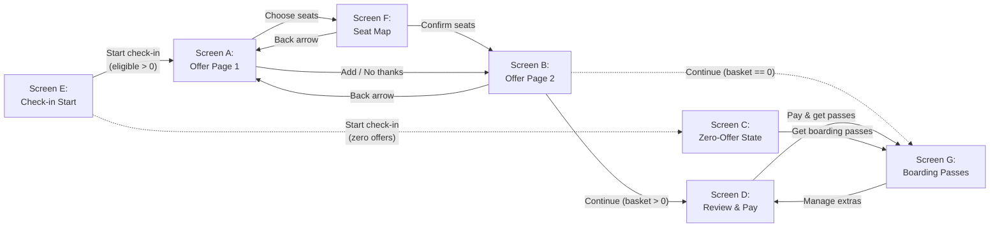

# Frontend Architecture & UI Specification: App 2026 Help Hub (`frontend` Track)

**Author:** Lead Engineer, Agentic Co-Engineer (`frontend` Track)
**Reviewers:** Product Design & Delivery, ADK Track Lead
**Status:** Approved (Gate 1: Specify)
**Last Updated:** 2026-10-06

---

## 1. Overview

This document specifies the frontend architecture, design tokens, component hierarchy, screen-by-screen state machine, and API integration rules for the **`frontend` track** (`dev/ui/`) of **Ryanair Dynamic Ancillary Flows (`ryta`)**.

The frontend will be imported from the Stitch prototype and integrated with the FastAPI/ADK backend (`dev/core/`) via the JSON Schema contracts in `contracts/`. It renders a mobile-first portrait interface (iOS/Android viewport) adhering strictly to the **App 2026 Help Hub** light-theme design system (`../scratchpad/stitch/DESIGN.md`), alongside a companion desktop analytics view (**Screen 10**) displaying the real-time model feedback loop.

---

## 2. Design System Tokens & Component Invariants

All screens in `dev/ui/` must enforce the tokens and visual rules defined in [`../scratchpad/stitch/DESIGN.md`](../scratchpad/stitch/DESIGN.md).

### 2.1 Color & Surface Tokens

| Token Name | Hex Value | Usage & Constraints |
|---|---|---|
| `surface/page` | `#FFFFFF` | Primary light-theme page background and standard task card surface. |
| `surface/ai` | `#F2F1FE` | Pale lavender surface reserved **exclusively** for assistant insight panels; never used on ordinary cards. |
| `brand/navy` | `#073590` | Top app header block, primary text, solid primary CTA buttons, and outlined pill button borders. |
| `brand/yellow` | `#F1C933` | Harp logo, avatar ring, status badges (`"Check-in open"`), and seat map Row 12 highlight (`12A–12D`). Use sparingly. |
| `accent/ai` | `#4B2EDB` | Sparkle avatar icon and first-person headings inside the lavender assistant panel. |
| `border/hairline` | `#E4E7EC` | `1px solid` border on white cards (`12px` border radius). |
| `text/heading` | `#10131A` | Primary card and section headings. |
| `text/body` | `#5B6472` | Supporting meta lines and descriptions (`13–14px` regular). |
| `pill/*` | Indigo / Amber / Green / Orange | `pill/next` (`"Your usual"`, indigo), `pill/review` (`"Recommended"`, amber), `pill/done` (green), `pill/plan` (orange). |

### 2.2 Typography, Shape, and Spacing

* **Type Scale:** Greeting `32px bold`; Section heading `22px bold`; Card title `16px semibold`; Price callout `18px bold`; Body & meta `13–14px regular`; Overline `11px uppercase` with `0.08em` letter-spacing on a pale blue pill.
* **Geometry:** Screen horizontal padding `20px`; standard card radius `12px`; assistant insight panel radius `18px` with `12px` inner card padding; buttons are fully rounded pills (`9999px`); vertical rhythm between sections `16–24px`.

---

## 3. Screen Catalog, Header Ladder, and Step-Numbering Matrix

The user journey comprises 7 mobile screens (`Screens E, A, F, B, D, C, G`), a transient skeleton loading state (`~300–600ms` while `POST /api/v1/checkin/sessions` resolves), and 1 internal analytics companion view (`Screen 10`).

### 3.1 Header Ladder & Step-Numbering Matrix

To preserve the `"2 steps"` promise and prevent greeting fatigue, every screen must obey the header ladder and step-numbering matrix from [`../scratchpad/stitch/stitch-build-runbook.md`](../scratchpad/stitch/stitch-build-runbook.md):

| Screen ID & Name | Journey Order | Header Variant | Step Indicator | Key Components Rendered |
|---|---|---|---|---|
| **Screen E:** Check-in Start | `1` (Entry) | **Full greeting header** (`"Hi Marta,"`, harp logo, subtitle, avatar, bell) | `"2 STEPS TO YOUR BOARDING PASSES"` | Flight card (`DUB → FAO`, `FR1234 · 06:35`), `"4 PASSENGERS"` list (`Marta B`, `Declan B`, `Fia B · Child (6)`, `Oisín B · Child (9)`), `"Start check-in"` CTA. |
| **Transient:** Loading State | `1.5` | Compact (`"Check in"`) | None | Skeleton shimmer + microcopy `"Getting your trip ready."` (never mentions scoring or AI). |
| **Screen A:** Offer Page 1 | `2` | Compact (`←`, `"Check in"`, `"Step 1 of 2"`) | `"Step 1 of 2"` | Flight summary card; Lavender panel (`"You usually travel with Priority"`) containing **Card A** (`Priority & 2 Cabin Bags`, `€76 for 4 passengers`, `"Add"`) and **Card B** (`Sit together`, `€24 for 4 seats`, `"Choose seats"`); full-width `"No thanks, continue →"`. |
| **Screen F:** Seat Map | `2a` (Sub-screen of A) | Compact (`←`, `"Choose your seats"`) | **None** (sub-screen, not a step) | Boeing 737 seat map with **`12A–12D`** highlighted in yellow (`"Best row for your group"`), child-ineligible rows greyed out, lavender panel (`"I've found 4 seats together"`), sticky footer (`"4 seats · €24.00"`, `"Confirm seats"`). |
| **Screen B:** Offer Page 2 | `3` | Compact (`←`, `"Check in"`, `"Step 2 of 2"`) | `"Step 2 of 2"` | Heading `"Anything in the hold?"`; Lavender panel (`"Most families on this route add a bag"`) with **Card C** (`20kg Checked Bag`, `€39.99`, stepper `0`, `"Add"`); collapsed drawer `"More extras (1)"` (expands inline to `Car hire in Faro`); full-width `"No thanks, continue →"`. |
| **Screen D:** Review & Pay | `4` (Conditional: `basket > 0`) | Compact (`←`, `"Review your extras"`) | **None** (checkout is not a step) | Removable line items (`Priority & 2 Cabin Bags ×4 €76.00`, `Seats 12A–12D €24.00`, `Checked bag 20kg €39.99`), `Total €139.99`, saved `Visa ending 4412`, `"Pay and get boarding passes"`. |
| **Screen G:** Boarding Passes | `5` (Terminal) | Compact (`"Boarding passes"`) | **None** | Swipeable stack of 4 passes (`1 of 4`, `Marta Byrne`, QR code, `DUB → FAO`, `FR1234 · 06:35`, badges `PRIORITY` & `12A`), `"Add all to Apple Wallet"`, `"Changed your mind? Manage extras"`. |
| **Screen C:** Zero-Offer State | `1-alt` (Branch off E) | **Full greeting header** (`"Hi Marta,"`) | `"1 STEP"` | Flight card (`DUB → FAO`, no seat number), Lavender panel (`"You're all set"` / `"Nothing else to add for this trip."`), `"Get boarding passes"` CTA (zero offer cards). |
| **Screen 10:** Ops Feedback Loop | Companion View | Desktop / Drawer Header | N/A | 4 KPI tiles (Conversion `24.1%` `+6.3pp`, Pages/check-in `1.8` vs `4.6`, Median time `71s` vs `2m 14s`, Offers shown `2.4`), take-up bar chart, ranked offers table + live persona/signal switcher. |

---

## 4. Navigation Wiring & Prototype Repair Checklist

### 4.1 Screen-to-Screen Wiring Rules

The frontend router (`dev/ui/`) and backend `next_screen` pointer must enforce the exact link table from [`../scratchpad/stitch/stitch-flow-map.md`](../scratchpad/stitch/stitch-flow-map.md):

Two critical navigation traps must be prevented in client state:

1. **Seat Map Forward Progression:** Tapping `"Confirm seats"` on **Screen F** navigates directly to **Screen B (Offer Page 2)**, never back to **Screen A (Offer Page 1)**.
2. **Offer Page 2 Back Navigation:** Tapping the back arrow on **Screen B (Offer Page 2)** navigates to **Screen A (Offer Page 1)**, never to **Screen F (Seat Map)**.

### 4.2 Stitch Import Sanitization Checklist

When importing the exported Stitch prototype into `dev/ui/`, the following four repairs from [`../scratchpad/stitch/stitch-flow-map.md`](../scratchpad/stitch/stitch-flow-map.md) (§"Still outstanding") must be applied and verified via automated tests:

1. **Seat Map (`Screen F`) Timer Removal:** Strip any `"Seats held for 09:42"` countdown text from the lavender panel. No timers are permitted anywhere in the UI.
2. **Zero-Offer (`Screen C`) Seat Badge Removal:** Remove any `"Seat 14A"` label from the flight card on the Zero-Offer screen.
3. **Offer Page 2 (`Screen B`) Copy Cleanup:** Replace `"Customise your checked luggage allowance for your return journey"` with `"Customise your checked luggage allowance for this flight"` and remove any `"Guaranteed cabin companion or gate bag refund guarantee"` text.
4. **Check-in Start (`Screen E`) Child Ages:** Ensure the passenger list displays `Fia B · Child (6)` and `Oisín B · Child (9)`.

---

## 5. Client-Server API Integration (`dev/ui/`)

The frontend communicates exclusively with the FastAPI backend via typed fetch wrappers validating against `contracts/`:

1. **Session Boot (`Screen E`):** Calls `POST /api/v1/checkin/sessions` with the selected `persona_id` (`"marta_byrne"` or `"zero_offer"`) and optional `signal_overrides` from the demo control bar. Renders `entry_step_pill` (`"2 STEPS TO YOUR BOARDING PASSES"` or `"1 STEP"`).
2. **Help Hub Question Submission & ADK Live Simulation (`Screen E`):** Submitting a question or natural-language simulation prompt in the `"Ask or search for help with this trip"` search bar (or tapping a quick-ask chip) calls `POST /api/v1/checkin/sessions/{id}/assist`. The UI renders the `#F2F1FE` (`surface/ai`) response card with invoked ADK tool pills and latency, synchronizes `ADK Live Simulation Controls` sliders (`#sim-trip-days`, `#sim-children`, `#sim-priority`, `#sim-declines`) and `#adk-live-trace-bar` when `state_mutated == true`, and refreshes **Screen 10** analytics.
3. **Offer Interactions (`Screens A & B`):** Calls `POST /api/v1/checkin/sessions/{id}/actions` when the user toggles Priority (`€76.00`), increments the 20kg Checked Bag stepper (`€39.99`), expands `"More extras (1)"`, or taps `"No thanks, continue →"`.
4. **Seat Selection (`Screen F`):** Calls `GET /api/v1/checkin/sessions/{id}/seat-map` to render Row 12 (`12A–12D`) and child-restricted rows, and `POST /api/v1/checkin/sessions/{id}/seats` on `"Confirm seats"`.
5. **Checkout & Boarding Passes (`Screens D & G`):** Calls `POST /api/v1/checkin/sessions/{id}/actions` (`action = "remove_item"`) for inline line-item removal on Review & Pay, and `POST /api/v1/checkin/sessions/{id}/checkout` to issue the 4 swipeable boarding passes with dynamic `PRIORITY` and `12A–12D` badges.
6. **Analytics View (`Screen 10`):** Polls or fetches `GET /api/v1/analytics/summary` to display live session telemetry alongside the benchmark KPI tiles.

---

## 6. References

* System Architecture Overview: [`./system-architecture.md`](./system-architecture.md)
* ADK & Backend API Specification: [`./adk-architecture.md`](./adk-architecture.md)
* Frontend Track Backlog: [`./frontend-user_stories.yaml`](./frontend-user_stories.yaml)
* Frontend Track State: [`../states/frontend.md`](../states/frontend.md)
* App 2026 Help Hub Design System: [`../scratchpad/stitch/DESIGN.md`](../scratchpad/stitch/DESIGN.md)
