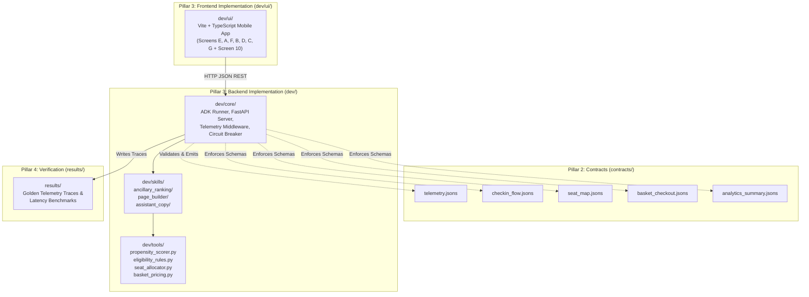
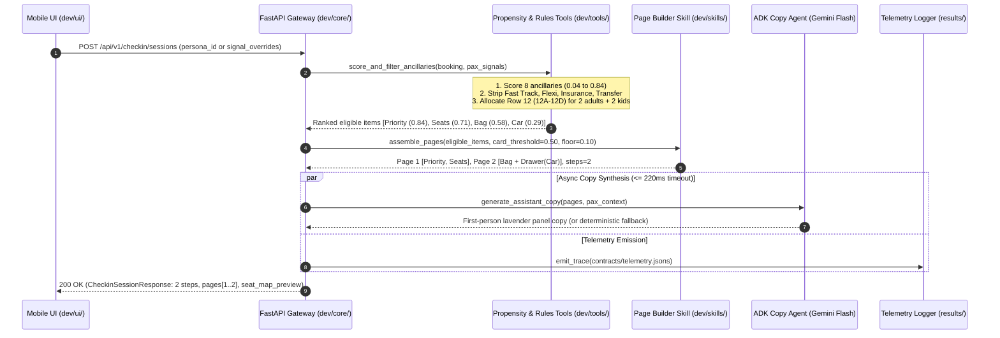
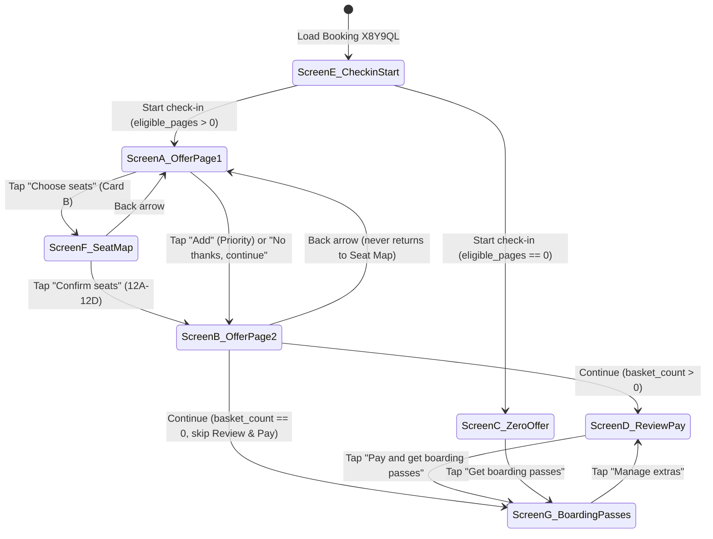

# System Architecture: Ryanair Dynamic Ancillary Flows (`ryta`)

**Author:** Lead Engineer, Agentic Co-Engineer
**Reviewers:** Engineering Architecture, Product Design & Delivery
**Status:** Approved (Gate 1: Specify)
**Last Updated:** 2026-10-06

---

## 1. Overview

This document defines the end-to-end system architecture for **Ryanair Dynamic Ancillary Flows (`ryta`)**. The system replaces the static 7-page linear check-in ancillary funnel with an AI-ranked, business-rule-filtered page builder that compresses the check-in journey into 0 to 2 personalized offer pages inside the App 2026 Help Hub design language.

When a passenger initiates check-in within 48 hours of departure, the backend executes a hybrid pipeline in ≤ 300ms (p95): deterministic domain tools compute ancillary purchase propensities, enforce hard route and regulatory eligibility rules, and pack surviving offers into at most 2 pages, while a Google Agent Development Kit (**ADK**) agent (`gemini-3.8-flash` with deterministic template fallback) synthesizes first-person assistant copy explaining the personalization. This architecture targets an ancillary conversion rate of ≥ 24.1% (+6.3 percentage points over the static funnel), reduces average offer pages per check-in from 4.6 to ≤ 2.0, and reduces median time to boarding pass from 134 seconds to ≤ 75 seconds.

---

## 2. Context & Domain Invariants

Traditional airline check-in flows force every passenger through a fixed sequence of 7 or more ancillary upsell screens (Priority Boarding, Reserved Seating, Checked Bags, Fast Track, Travel Insurance, Car Hire, Airport Transfers, and Fare Upgrades) regardless of route eligibility or historical purchase behavior. Passengers develop banner blindness and tap skip repeatedly, degrading both check-in completion speed and ancillary attach rates.

The design brief and prototypes in [`../scratchpad/stitch/ryanair-dynamic-flows-stitch-brief.md`](../scratchpad/stitch/ryanair-dynamic-flows-stitch-brief.md), [`../scratchpad/stitch/stitch-build-runbook.md`](../scratchpad/stitch/stitch-build-runbook.md), [`../scratchpad/stitch/stitch-flow-map.md`](../scratchpad/stitch/stitch-flow-map.md), and [`../scratchpad/stitch/DESIGN.md`](../scratchpad/stitch/DESIGN.md) establish two non-negotiable sets of system invariants: the **Stitch Consistency Contract** and the **UX & Flow Invariants**.

### 2.1 The Stitch Consistency Contract (Canonical Fixture Data)

All backend default fixtures, unit tests, and frontend prototype screens must return and render the exact canonical values listed in the table below:

| Domain Attribute | Canonical Value | Invariant Rule |
|---|---|---|
| **Airline** | `Ryanair` | Never substitute or invent another carrier name or IATA code. |
| **Flight & Route** | `FR1234`, Dublin (`DUB` Terminal 1) → Faro (`FAO`) | Outbound leg only; never reference the return leg on offer cards. |
| **Schedule & Gate** | Tuesday 14 October, departs `06:35`, boarding `05:55`, gate closes `06:05`, Gate `104` | Check-in opens 48 hours prior to departure; trip length is `7 nights` on a `Value` fare. |
| **Booking Reference** | `X8Y9QL` | Fixed across all 4 passengers on the booking. |
| **Passengers (4)** | `Marta Byrne` (lead booker, 34) `Declan B` (adult) `Fia B` (child, age 6) `Oisín B` (child, age 9) | Child ages (`6` and `9`) govern mandatory family seating adjacency and exit-row restrictions. |
| **Priority & 2 Cabin Bags** | `€76.00` total for 4 passengers (`€19.00` per passenger) | Ranked #1 (`score = 0.84`); repeat purchase on 3 of last 4 trips. |
| **Reserved Seats (×4)** | Row 12: `12A`, `12B`, `12C`, `12D` at `€6.00` per seat (`€24.00` total) | Ranked #2 (`score = 0.71`); never use Row 14 (`Seat 14A` is forbidden). |
| **20kg Checked Bag** | `€39.99` (outbound only, quantity stepper starting at `0`) | Ranked #3 (`score = 0.58`); contextualized for 7 nights and 4 travellers. |
| **Car Hire (Faro)** | Collapsed into `"More extras (1)"` drawer on Offer Page 2 | Ranked #4 (`score = 0.29`); below primary card threshold (`0.50`) but above display floor (`0.10`). |
| **Basket Checkout** | Total `€139.99` (`€76.00 + €24.00 + €39.99`), saved `Visa ending 4412` | Line items support individual removal; empty basket bypasses Review & Pay entirely. |

### 2.2 Product, UX, and Flow Invariants

Every API response and UI view must enforce the following six product invariants:

1. **Zero Pre-Selection:** Every ancillary toggle starts in the unselected state (`false`) and every quantity stepper starts at `0`. Conversion lift comes from relevance ranking and page compression, never from opt-out defaults.
2. **First-Class Decline Action:** Every offer page presents a full-width outlined pill button (`"No thanks, continue →"`) with the same visual weight as primary action buttons. Declining an offer suppresses that product for the remainder of the session without confirmation modals.
3. **Strict Step-Numbering Invariant:** Only the dynamic offer pages carry step numbers (`"Step 1 of 2"`, `"Step 2 of 2"`). Check-in Start displays the total offer page count (`"2 STEPS TO YOUR BOARDING PASSES"`, or `"1 STEP"` when zero offers qualify). The Seat Map (sub-screen of Offer Page 1), Review & Pay, and Boarding Passes never display step numbers.
4. **Header Ladder Invariant:** Full greeting headers (`"Hi Marta,"` with harp logo, subtitle, avatar, and bell icon) appear exclusively on entry screens (Screen E Check-in Start and Screen C Zero-Offer State). All subsequent task screens use compact navigation headers.
5. **Assistant Surface & Voice Isolation:** Lavender surfaces (`#F2F1FE`) and indigo sparkle headers (`#4B2EDB`) are reserved exclusively for assistant-generated insight panels. Assistant copy is written in the first person (for example, `"I've found 4 seats together"`) and is never labelled `"AI"`.
6. **Zero Urgency or Scarcity Dark Patterns:** Countdown timers (such as `"Seats held for 09:42"`) and scarcity badges (`"Only 2 left at this price"`) are forbidden across all backend payloads and UI components.

---

## 3. Goals, Non-Goals, and Quality Attribute Scenarios

### 3.1 Goals

* **Dynamic Funnel Compression:** Dynamically generate 0, 1, or 2 offer pages per check-in session based on passenger propensity scores and deterministic eligibility rules.
* **Sub-300ms Hybrid Orchestration:** Execute propensity scoring, business rule filtering, page layout packing, and ADK assistant copy synthesis within a server-side latency budget of p95 ≤ 300ms.
* **Multi-Persona & Live Signal Simulation:** Support the canonical Marta Byrne 2-step journey and the 1-step Zero-Offer branch out of the box, while allowing API callers to override passenger signals (trip length, pax mix, purchase history, time to departure) to demonstrate live re-ranking.
* **Closed-Loop Telemetry & Analytics:** Emit structured execution logs validating against [`contracts/telemetry.jsons`](../../contracts/telemetry.jsons) for every agent, skill, and tool invocation, and aggregate session metrics for the Screen 10 internal feedback dashboard.

### 3.2 Non-Goals

* **Core Airline PSS Replacement:** This system does not replace backend inventory, ticketing, or payment settlement engines; external airline subsystems are represented via deterministic tool interfaces.
* **Initial Flight Booking Flow:** Scope is restricted to the post-booking check-in and ancillary attach journey inside 48 hours before departure.
* **Unconstrained Free-Text Chat:** The check-in flow uses structured, card-based server-driven UI payloads rather than an open-ended conversational chatbot.

### 3.3 Falsifiable Quality Attribute (QA) Scenarios

The following table defines the falsifiable quality attribute scenarios governing Gate 3 and Gate 4 verification:

| Scenario ID | Quality Attribute | Stimulus & Source | Environment | System Response | Falsifiable Measure |
|---|---|---|---|---|---|
| **QA-01** | **Latency (Performance)** | Client requests check-in flow initialization (`POST /api/v1/checkin/sessions`) for a 4-passenger booking. | Normal load, warm FastAPI worker, Gemini Flash active. | Backend scores 8 ancillaries, filters 4 ineligible items, packs 2 pages, and returns structured page descriptors with assistant copy. | End-to-end server processing latency is **p50 ≤ 180ms** and **p95 ≤ 300ms**. |
| **QA-02** | **Availability (Resilience)** | Gemini API experiences elevated latency (> 220ms) or returns HTTP 429/503 during check-in initialization. | Degraded upstream LLM dependency. | Circuit breaker cancels the in-flight LLM call at 220ms and populates first-person assistant copy from deterministic templates in `dev/skills/`. | 100% HTTP 200 responses with valid schema payloads and total latency **≤ 260ms**. |
| **QA-03** | **Safety & Compliance** | Passenger checks in < 48h before departure on a route without return Fast Track and with 6 prior insurance declines. | All environments. | Deterministic rule filter strips Fast Track, Flexi upgrade, Travel Insurance, and sub-0.10 items regardless of LLM output; child seating rules block exit rows for ages 6 and 9. | **0% leakage** of ineligible or suppressed ancillaries across 100% of test traces. |
| **QA-04** | **Observability** | Any API endpoint executes an ADK agent, declarative skill, or deterministic tool. | All environments. | Telemetry middleware emits structured JSON logs containing trace IDs, span IDs, tenant/session context, and guardrail status. | **100% of emitted log records** validate against [`contracts/telemetry.jsons`](../../contracts/telemetry.jsons). |

---

## 4. Architectural Viewtypes

We decompose the system into three orthogonal architectural views: **Module View**, **Runtime View**, and **Allocation View**.

### 4.1 Module View (Static Code Decomposition)

The repository enforces the 4-Pillar Architecture defined in [`AGENTS.md`](../../AGENTS.md). Domain logic resides strictly inside declarative skills (`dev/skills/`) and modular tools (`dev/tools/`), while `dev/core/` remains domain-agnostic:

The responsibilities and boundaries of each module directory are detailed below:

| Module Path | Track Owner | Responsibility | Dependency Constraints |
|---|---|---|---|
| `contracts/` | Shared (`adk` + `frontend`) | Frozen JSON Schemas (`*.jsons`) defining telemetry, check-in session payloads, seat maps, basket checkout, and analytics. | Zero code dependencies; single source of truth for both tracks. |
| `dev/core/` | `adk` | FastAPI application factory, ADK `Runner` and session manager, 220ms LLM timeout circuit breaker, and OpenTelemetry log emitter. | Must not contain hardcoded airline products, prices, or route rules. |
| `dev/tools/` | `adk` | Pure, deterministic Python tools for propensity scoring, business rule filtering, Boeing 737 family seat allocation, and basket totals. | Stateless, deterministic, unit-testable in < 10ms without network I/O. |
| `dev/skills/` | `adk` | Declarative skill packages combining ADK instructions, copy rules, and deterministic fallback templates. | Invokes `dev/tools/` and conforms to `contracts/*.jsons`. |
| `dev/ui/` | `frontend` | Mobile-first Help Hub UI rendering Screens E, A, F, B, D, C, G, and the Screen 10 internal analytics view. | Consumes backend REST endpoints defined in `contracts/`. |
| `dev/tests/` | `adk` + `frontend` | Automated unit, contract validation, invariant, and latency benchmark tests. | Verifies 100% compliance with `contracts/` and `.blocked_terms`. |

### 4.2 Runtime View (Check-in Execution & State Machine)

During runtime execution, the backend orchestrates check-in initialization in a single pass so the client can transition smoothly from Screen E (Check-in Start) through the transient loading state into either the personalized 2-page funnel (Screen A → Screen B) or the 1-step Zero-Offer state (Screen C):

The screen transition state machine across the client and backend session state follows the graph below:

### 4.3 Allocation View (Deployment & Process Topology)

The prototype runs locally and in containerized staging environments as two decoupled processes communicating over HTTP REST and exporting OpenTelemetry traces:

| Runtime Unit | Technology Stack | Port / Endpoint | Scaling & Resource Profile |
|---|---|---|---|
| **Backend API & ADK Runtime** | Python 3.10+, FastAPI `0.141+`, Uvicorn, `google-adk 2.9+`, Pydantic `2.13+` | `http://0.0.0.0:8000` | Stateless worker processes; in-memory session store with JSON snapshot persistence in `results/`. |
| **LLM Inference Upstream** | Google Gemini API (`gemini-3.8-flash` primary, `gemini-3.1-pro` fallback/eval) | HTTPS (`generativelanguage.googleapis.com`) | Governed by a 220ms per-request circuit breaker to guarantee the 300ms SLA. |
| **Frontend Web/Mobile App** | Vite, TypeScript, HTML/CSS (390×844 mobile viewport frame + desktop analytics view) | `http://localhost:5173` (dev) or static mount on `:8000` | Client-side state hydrated from `/api/v1/checkin/*` and `/api/v1/analytics/*`. |
| **Telemetry Sink** | OpenTelemetry OTLP Exporter + local JSONL audit log | `http://localhost:4317` & `results/telemetry_traces.jsonl` | Every request appends schema-validated events to `results/` for Gate 4 verification. |

---

## 5. Rational Trade-Off Decisions (ADRs)

### 5.1 ADR-01: Hybrid ADK + Deterministic Tools vs. Pure LLM End-to-End Scoring

* **Decision:** We adopt a **Hybrid ADK + Deterministic Tools** architecture. Deterministic Python tools calculate propensity scores, apply hard eligibility and suppression rules, validate child-seating safety, and compute exact euro prices; the ADK agent (`gemini-3.8-flash`) orchestrates the workflow and generates contextual first-person assistant copy with a deterministic fallback.
* **Rationale:** Airline pricing (`€76.00`, `€24.00`, `€39.99`, `€139.99`), child seating regulations (ages 6 and 9 cannot occupy emergency exit rows and require adjacent adult supervision), and 48-hour cutoff rules require 100% mathematical and regulatory determinism. Meanwhile, Gemini excels at synthesizing concise, empathetic first-person copy tailored to passenger signals.
* **Rejected Alternative 1 (Pure LLM End-to-End Scoring & Pricing):** Rejected because LLM arithmetic and rule filtering can hallucinate prices (violating the Consistency Contract) and exceed the 300ms p95 latency budget.
* **Rejected Alternative 2 (Static Rule Engine Without ADK):** Rejected because hardcoded string concatenation cannot dynamically adapt assistant explanations when stakeholders test novel passenger personas or override live trip signals via the API.

### 5.2 ADR-02: Server-Driven Page Builder vs. Client-Side Funnel Filtering

* **Decision:** The backend computes the exact page count (`total_steps`), groups cards into pages, separates primary cards from collapsed drawer items, and returns a structured `CheckinFlowResponse` payload.
* **Rationale:** Centralizing page assembly on the server ensures that the progress indicator on Screen E (`"2 STEPS TO YOUR BOARDING PASSES"` vs. `"1 STEP"`) is guaranteed to match the actual number of offer pages rendered, and allows backend telemetry to record exact offers shown vs. offers taken for the Screen 10 model feedback loop.
* **Rejected Alternative (Client-Side Filtering of All 8 Ancillaries):** Rejected because shipping ineligible products to the client leaks suppressed offers into network payloads and splits business thresholds across Python and TypeScript.

---

## 6. Cross-Track Contract Registry (`contracts/`)

Per the Multi-User Concurrency Protocol in [`AGENTS.md`](../../AGENTS.md), the `contracts/` directory is the sole integration boundary between the `adk` and `frontend` tracks. The table below defines the contract suite required for Gate 2:

| Contract Schema File | Version | Producer | Consumer | Purpose |
|---|---|---|---|---|
| [`contracts/telemetry.jsons`](../../contracts/telemetry.jsons) | `1.0.0` (Frozen) | `adk`, `frontend` | Verify (`results/`) | Standardized OpenTelemetry & execution log schema for all agent, skill, and tool calls. |
| `contracts/checkin_flow.jsons` | `1.0.0` (Gate 2) | `adk` | `frontend` | Request/response schema for session creation, passenger signal overrides, ranked ancillaries, dynamic offer pages, assistant copy panels, and step counts. |
| `contracts/seat_map.jsons` | `1.0.0` (Gate 2) | `adk` | `frontend` | Boeing 737 cabin grid schema, recommended family block (`12A–12D`), child-restricted row metadata, and seat selection confirmation. |
| `contracts/basket_checkout.jsons` | `1.0.0` (Gate 2) | `adk` | `frontend` | Session basket mutation (add, update quantity, decline, remove line item), payment confirmation (`Visa ending 4412`), and boarding pass issuance (`PRIORITY`, `12A` badges). |
| `contracts/analytics_summary.jsons` | `1.0.0` (Gate 2) | `adk` | `frontend` | Aggregated KPI metrics for Screen 10: ancillary conversion rate, pages per check-in, median time to boarding pass, offers shown per passenger, and take-up breakdown. |

---

## 7. Operational Resilience, Security, and Rollback Plan

### 7.1 Failure Modes & Mitigations

| Failure Mode | Detection Mechanism | Automated Mitigation | User-Visible Impact |
|---|---|---|---|
| **Gemini API Latency Spike (> 220ms) or Outage** | Async `asyncio.wait_for` timeout or HTTP 4xx/5xx exception in `dev/core/`. | Immediately fall back to deterministic first-person copy templates in `dev/skills/assistant_copy/` and log `payload.status = "SUCCESS"` with fallback metadata. | Zero degradation; passenger receives valid first-person assistant copy within ≤ 260ms. |
| **LLM Copy Violates Guardrails (Mentions "AI", Timer, or Wrong Price)** | Post-generation regex and invariant validator in `dev/skills/assistant_copy/`. | Set `security.guardrail_status = "BLOCK"`, discard LLM string, and substitute deterministic template copy. | Zero dark patterns or hallucinated prices ever reach the UI. |
| **All Ancillaries Filtered Out** | `len(eligible_ancillaries) == 0` in `dev/skills/page_builder/`. | Route session to the **Zero-Offer State** (`total_steps = 1`, Screen C) with `"You're all set"` assistant copy and direct transition to Boarding Passes. | Passenger completes check-in in 1 step without empty or broken offer screens. |

### 7.2 Security, Privacy, and Rollback

* **PII Sanitization:** Passenger names in fixture data (`Marta Byrne`, `Declan B`, `Fia B`, `Oisín B`) are synthetic persona constants. Telemetry payloads logged to `results/` hash or redact raw payment tokens and include only pseudonymous `session_id`, `tenant_id`, and `user_id` fields per [`contracts/telemetry.jsons`](../../contracts/telemetry.jsons).
* **1-Click Rollback:** The page builder exposes a configuration toggle (`DYNAMIC_FLOW_ENABLED=true`). If production conversion or error SLOs breach thresholds, toggling `DYNAMIC_FLOW_ENABLED=false` bypasses dynamic offer pages and routes check-in sessions cleanly through standard boarding pass issuance.

---

## 8. References

* Collaboration & Gate Protocol: [`AGENTS.md`](../../AGENTS.md)
* ADK Backend Technical Specification: [`./adk-architecture.md`](./adk-architecture.md)
* Frontend Technical Specification: [`./frontend-architecture.md`](./frontend-architecture.md)
* Stitch Customer Journey Brief: [`../scratchpad/stitch/ryanair-dynamic-flows-stitch-brief.md`](../scratchpad/stitch/ryanair-dynamic-flows-stitch-brief.md)
* Stitch Build Runbook & Consistency Contract: [`../scratchpad/stitch/stitch-build-runbook.md`](../scratchpad/stitch/stitch-build-runbook.md)
* Stitch Flow Map & Wiring Rules: [`../scratchpad/stitch/stitch-flow-map.md`](../scratchpad/stitch/stitch-flow-map.md)
* App 2026 Help Hub Design System Tokens: [`../scratchpad/stitch/DESIGN.md`](../scratchpad/stitch/DESIGN.md)
