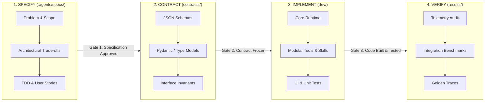

# Ryanair Dynamic Ancillary Flows (`ryta`)

Welcome to the **Ryanair Dynamic Ancillary Flows** project. This document defines the mission, workspace taxonomy, 4-stage assembly line lifecycle, and collaboration conventions for AI agents and human engineers working together in this repository.

---

## 1. Project Mission & Objectives

Our mission is to engineer the **Dynamic Check-in & Ancillary Flow Engine** to replace the fixed 7-page linear ancillary funnel with an AI-ranked, business-rule-filtered, 0-to-2-page personalized check-in experience for **Ryanair mobile app passengers** in the App 2026 Help Hub design language.

### Key Objectives

This project targets the following measurable outcomes:

* **Objective 1 (Check-in Funnel Compression):** Compress the ancillary offer flow from 4.6 average pages per check-in to ≤ 2.0 offer pages (and 0 offer pages when no products pass eligibility and threshold filters), reducing median check-in completion time from 134s to ≤ 75s.
* **Objective 2 (Low-Latency Hybrid Scoring & Page Assembly):** Score all candidate ancillaries, enforce hard business eligibility and suppression rules, assemble dynamic page layouts, and synthesize first-person assistant copy within a server-side latency budget of p95 ≤ 300ms (with deterministic copy fallback if LLM generation exceeds 220ms).
* **Objective 3 (Ancillary Conversion & Ethical UX):** Increase ancillary conversion to ≥ 24.1% (+6.3 percentage points over the static flow) while strictly enforcing zero pre-selection, first-class decline affordances, and zero urgency/scarcity dark patterns.
* **Objective 4 (Observability & Feedback Loop):** Emit 100% schema-valid execution traces conforming to [`contracts/telemetry.jsons`](./contracts/telemetry.jsons) and expose real-time funnel metrics for the internal model feedback loop dashboard.

### Non-Goals

The following items are explicitly out of scope for this repository:

* **Non-Goal 1 (Core PSS / Reservation System Replacement):** We do not replace the underlying Passenger Service System (PSS), flight inventory, or payment gateway; those are modeled via deterministic domain tools and fixture state.
* **Non-Goal 2 (Initial Flight Search & Ticket Booking):** This system governs the post-booking **check-in and ancillary attach flow** (48h prior to departure), not initial flight search or base fare booking.
* **Non-Goal 3 (Dark-Pattern Optimization):** Pre-selected extras, hidden decline links, artificial countdown timers, and scarcity counters are strictly prohibited.

---

## 2. Workspace Taxonomy: The 4-Pillar Architecture

To ensure speed and rigorous separation of concerns during rapid prototyping and multi-track delivery, all repository assets are organized into four dedicated pillars plus a shared agent continuity layer under `.agents/`:

```
project-root/
├── AGENTS.md                   # Collaboration protocol and operating rules (this document)
├── README.md                   # Human onboarding, environment setup, and quickstart
│
├── .agents/                    # AGENT WORKSPACE, SPECIFICATIONS & CONTINUITY LAYER
│   ├── README.md               # Overview and fast-boot routing instructions
│   ├── specs/                  # PILLAR 1 (Specify): Human-readable TDDs, blueprints, user stories
│   ├── states/                 # Active working context & track roadmaps (shared.md, <track>.md)
│   ├── sessions/               # Append-only chronological session handover logs (<track>/)
│   ├── scratchpad/             # Unstructured ideation, brainstorming, and early spikes (<track>/)
│   └── skills/                 # Project-scoped declarative agent skills (SKILL.md packages)
│
├── contracts/                  # PILLAR 2 (Contract): Strict, machine-readable schemas
│   ├── telemetry.jsons         # JSON Schema for execution logs and OpenTelemetry traces
│   └── ...                     # Domain schemas (skill_schema.jsons, tool_schema.jsons, etc.)
│
├── dev/                        # PILLAR 3 (Implement): Runnable implementation code
│   ├── core/                   # Runtime engine, orchestrator, runner, and telemetry hooks
│   ├── tools/                  # Standardized, reusable tool integrations
│   ├── skills/                 # Declarative domain skill implementations
│   ├── ui/                     # Frontend application and dynamic UI components
│   └── tests/                  # Automated unit and integration test suites
│
└── results/                    # PILLAR 4 (Verify): Empirical proofs, benchmarks, and traces
```

### Pillar Definitions & Roles

| Pillar | Directory | Purpose | Mutability & Lifecycle |
|---|---|---|---|
| **Specify** | `.agents/specs/` | Technical Design Documents (TDDs), architectural blueprints, requirements analysis, and user stories. | Living markdown and YAML documents during design and specification phases. |
| **Contract** | `contracts/` | Strict machine-readable contracts (JSON Schemas, Pydantic specs, API interfaces). Single source of truth. | Version-controlled, frozen contracts that code and external systems depend upon. |
| **Implement** | `dev/` | Production and prototype code: runtime engine, modular tools, declarative skills, UI components, and tests. | Continuously developed against contracts in `contracts/`. |
| **Verify** | `results/` | Empirical outcomes: telemetry traces, evaluation metrics, latency benchmarks, and demonstration payloads. | Output artifacts generated from test runs and evaluations. |

---

## 3. The 4-Stage Prototyping Assembly Line

Every capability, tool, skill, or integration follows a formal 4-stage lifecycle gate:



### Stage-Gate Exit Criteria

1. **Gate 1 (Specify → Contract):**
   - The specification document in `.agents/specs/` states the problem definition, non-goals, and component boundaries.
   - Lead Engineer approves the architectural direction.
2. **Gate 2 (Contract → Implement):**
   - Machine-readable contracts in `contracts/` are formalized and syntactically valid.
   - Cross-track interfaces and telemetry schemas are aligned in [.agents/states/shared.md](./.agents/states/shared.md).
3. **Gate 3 (Implement → Verify):**
   - Code in `dev/` passes linting, formatting, and automated unit tests.
   - Runtime execution wraps I/O with telemetry emission conforming to [contracts/telemetry.jsons](./contracts/telemetry.jsons).
4. **Gate 4 (Verify → Deliver):**
   - End-to-end execution generates valid trace logs and benchmark artifacts in `results/` meeting target thresholds.

---

## 4. Human-Agent Pairing Model

We operate as a high-velocity pair programming team:

* **Lead Engineer (Human / Principal Architect):**
  - Defines project goals, priorities, and domain nuances.
  - Reviews and signs off on architectural gates.
  - Aligns with domain stakeholders and partner engineering teams.

* **Agentic Co-Engineer (Jetski / Staff AI Partner):**
  - Synthesizes existing codebase patterns and requirements into structured proposals.
  - Drafts TDDs in `.agents/specs/` and formal contracts in `contracts/`.
  - Implements clean, decoupled modules and automated tests in `dev/`.
  - Validates all executions against telemetry and evaluation contracts.

---

## 5. Agent Operating Rules

1. **Contract-First Development:** Never implement code in `dev/` without an agreed specification in `.agents/specs/` and formal schemas in `contracts/`.
2. **Observability Compliance:** Every agent execution, tool call, and state transition must emit logs conforming to [contracts/telemetry.jsons](./contracts/telemetry.jsons).
3. **Decoupled Architecture:** No hardcoded business logic or domain-specific rules inside `dev/core/`. Domain logic belongs strictly in declarative packages inside `dev/skills/`.
4. **Hyperlink Files & PII Prevention:**
   - **In Committed Repository Files (`.md`):** Always use workspace-relative markdown links (e.g., `[telemetry.jsons](./contracts/telemetry.jsons)`). **Never** write `file:///...` URLs into committed files, as absolute paths break across developer machines and leak local usernames/LDAPs.
   - **In Chat Responses:** Always use clickable `file:///...` markdown links (with line ranges where applicable) when referencing files, code symbols, or documentation in chat for fast IDE navigation.
5. **Continuous Roadmap Alignment:** Keep track roadmaps in [`.agents/states/adk.md`](./.agents/states/adk.md) and [`.agents/states/frontend.md`](./.agents/states/frontend.md) and backlogs in [`.agents/specs/adk-user_stories.yaml`](./.agents/specs/adk-user_stories.yaml) and [`.agents/specs/frontend-user_stories.yaml`](./.agents/specs/frontend-user_stories.yaml) synchronized as milestones and gates are achieved.
6. **PII & Naming Guardrails:** Never include developer names, personal LDAPs, or internal project IDs in repository content (enforced via `.blocked_terms` pre-commit hook). Use role-based titles (`"Lead Engineer"`, `"Agentic Co-Engineer"`) for document authorship, `example.com` for sample emails, and `example-*` for sample GCP project IDs. Domain fixtures defined in the Stitch Consistency Contract (`Ryanair`, `FR1234`, `DUB → FAO`, `Marta Byrne`, `X8Y9QL`) are explicitly permitted so backend payloads match the frontend prototype verbatim.
7. **Session Continuity & Shared Memory:** At session boot, agents MUST read the relevant track state in [.agents/states/COMPONENT.md](./.agents/states/COMPONENT.md) and cross-track integration state in [.agents/states/shared.md](./.agents/states/shared.md).
   At the close of a session or completion of a significant task, append a date-stamped session handover note under `.agents/sessions/<track>/YYYY-MM-DD_<topic>.md` and update the corresponding state file in `.agents/states/` when milestone or gate status changes. Raw brainstorms and spike notes belong in `.agents/scratchpad/`.
8. **Human Consent for Specifications & Operating Rules:** Any additions, modifications, or deletions to documents in `.agents/specs/` or to [AGENTS.md](./AGENTS.md) itself require explicit human consent from the Lead Engineer. Agents may propose changes (via chat diffs, interactive questions, or drafts in `.agents/scratchpad/`), but must never directly write to or edit these files without prior approval.
9. **Catalog Skills for Reviews & Quality Control:** For non-trivial specification changes, architecture designs, and code reviews, agents MUST discover and activate specialized review skills from the Google internal catalog (via `skill_search` and reading their `SKILL.md` instructions):
   - **Specification Reviews:** Use `design-doc-reviewer` (structured probe and gap analysis), `design-doc-readability` (6-phase engineering rigor: scoping, viewtypes, trade-offs, contract design, failure modeling), and `technical-writing` (clarity, conciseness, terminology precision).
   - **Code & Security Reviews:** Use `code-taste` (abstraction depth, structural elegance, edge-case elimination, cognitive simplicity), `review-loop` / `review` (multi-expert code review and ranked findings `P0`–`P3`), and `securitysupercharge` / `pii-review` (vulnerability scanning and data privacy audits).

---

## 6. Multi-User & Multi-Agent Concurrency Protocol

When multiple engineers and AI agents work concurrently across tracks (e.g., `frontend` and `adk`), follow these boundaries to prevent merge conflicts and broken integrations:

1. **Contract Handshake (`contracts/`):** The `contracts/` directory is the sole integration boundary between tracks. No track may alter shared payload structures without updating the schema in `contracts/` and recording the version update in [.agents/states/shared.md](./.agents/states/shared.md).
2. **Conflict-Free Session Logging:** Feature branches must write session handover notes as new, date-stamped files in `.agents/sessions/<track>/YYYY-MM-DD_<topic>.md` rather than appending to shared files. Keep `.agents/states/<track>.md` concise and tabular to minimize merge contention.
3. **Subagent Worktree Isolation:** When spawning parallel subagents for implementation tasks, isolate each subagent in a branched or shared worktree (`Workspace: "branch"` or `"share"`) and restrict its file writes to its assigned track and module directory.
